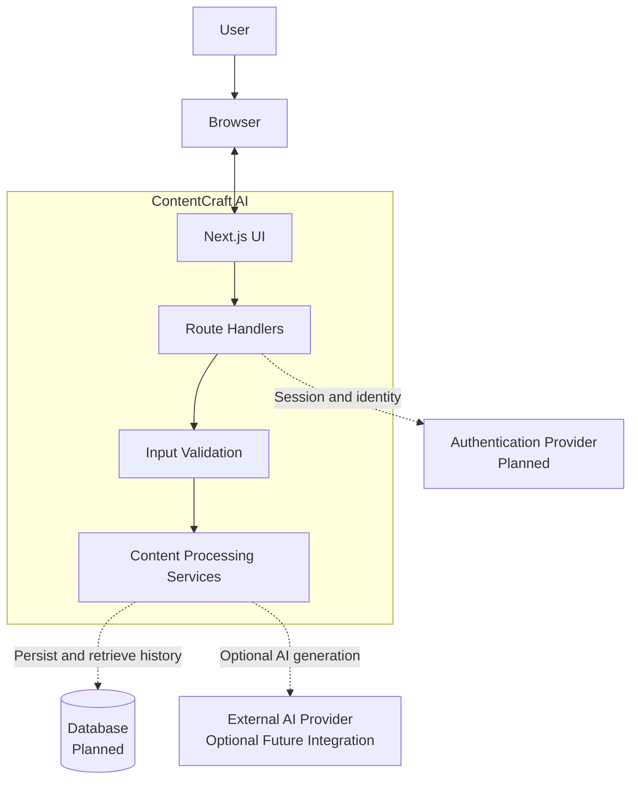
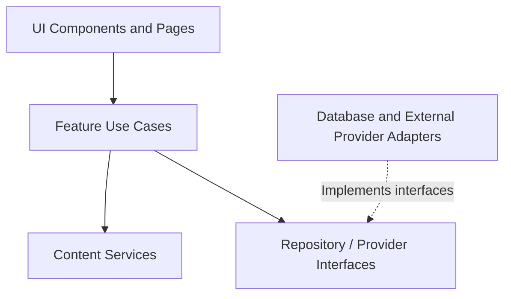
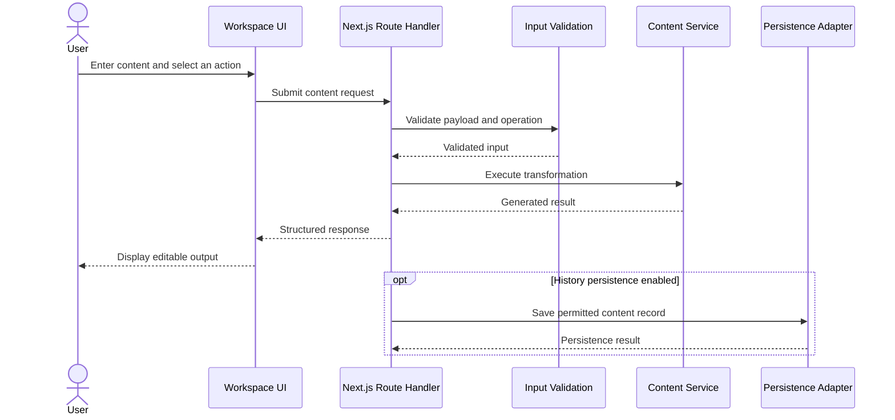
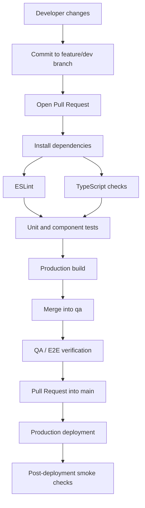
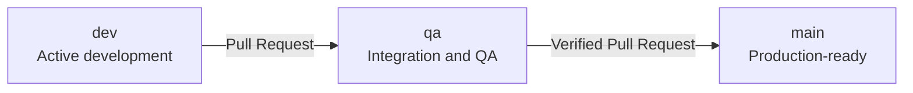

# ContentCraft AI

> Turn ideas into impactful content.

**ContentCraft AI** is an AI-assisted content productivity application designed to help users transform, improve, simplify, summarize, and generate content through a focused workspace.

This repository uses a modern Next.js application architecture, with an incremental development approach: establish a reliable UI and deterministic content-processing MVP first, then introduce persistence, authentication, and external AI integrations when required.

---

## Table of Contents

- [Project Overview](#project-overview)
- [Assumptions and Implementation Status](#assumptions-and-implementation-status)
- [1. System Design](#1-system-design)
- [2. Project Architecture](#2-project-architecture)
- [3. Build, Test, and Deployment Pipeline](#3-build-test-and-deployment-pipeline)
- [Environment Configuration](#environment-configuration)
- [Development Workflow](#development-workflow)
- [Getting Started](#getting-started)
- [Engineering Principles](#engineering-principles)

---

## Project Overview

### Core capabilities

The planned product scope includes:

- **Content transformation:** rewrite, simplify, and summarize text.
- **Content generation:** create social media posts and other content formats.
- **Workspace:** edit input and generated output in a focused interface.
- **Content history:** revisit and reuse previous results.
- **Dashboard:** access common actions, recent content, and usage information.
- **Theme support:** consistent light and dark experiences.

### Technology stack

| Layer | Technology | Responsibility |
|---|---|---|
| Web framework | Next.js 16 App Router | Routing, rendering, and application entry points |
| Language | TypeScript | Static typing and maintainability |
| UI runtime | React 19 | Component-based interface |
| Styling | Tailwind CSS v4 | Utility-first styling and responsive layouts |
| Typography | Geist | Application typography |
| Icons | Lucide | Consistent interface iconography |
| Validation | Zod, where needed | Runtime validation of inputs and data |
| Forms | React Hook Form, where needed | Form state and validation integration |
| Unit/component tests | Vitest and React Testing Library | Logic and UI behavior |
| End-to-end tests | Playwright | Critical user journeys |
| Version control | Git and GitHub | Source history and collaboration |
| CI/CD | GitHub Actions, planned | Automated verification and deployment |
| Persistence | MongoDB Atlas Free, under consideration | Future durable user/content storage |
| Authentication | Auth.js or another single selected provider, planned | Future identity and session management |

> The table describes the intended technology direction. A dependency being listed does not imply that it has already been installed or integrated.

---

## Assumptions and Implementation Status

This document distinguishes the current application foundation from the target architecture.

- **Current foundation:** Next.js App Router, TypeScript, React, Tailwind CSS v4, and Geist.
- **MVP direction:** deterministic, local content transformations that do not require a paid AI API.
- **Planned backend:** Next.js Route Handlers for operations that need server-side execution.
- **Planned persistence:** a database-backed content history and user-specific data.
- **Planned authentication:** one authentication system, selected before user accounts are implemented.
- **Planned automation:** CI checks and a controlled development → QA → production workflow.

The target diagrams are architectural blueprints, not claims that every component is already implemented. The initial architecture deliberately avoids requiring a separate backend server or a paid external AI service.

---

# 1. System Design

## 1.1 High-level system context

The system is organized around the web application, its content-processing capabilities, and optional external services introduced as the product evolves.



**Explanation**

- The browser renders the user interface and collects user input.
- Next.js handles page rendering and application routing.
- Route Handlers provide server-side entry points for operations that require them.
- Content Processing Services own transformation logic and should not depend on UI components.
- Database, authentication, and external AI integrations are future dependencies, not mandatory requirements for the initial MVP.

The first implementation can process content locally or through server-side deterministic services, depending on the feature's security and execution requirements.

## 1.2 Component responsibilities

| Component | Responsibility | Boundary |
|---|---|---|
| Presentation layer | Pages, layouts, reusable UI, responsive states | Does not own persistence logic |
| Feature layer | Dashboard, workspace, history, content actions | Coordinates user-facing use cases |
| Validation layer | Input schemas, supported operations, constraints | Rejects invalid input before processing |
| Content services | Rewrite, summarize, simplify, generate | Framework-independent business logic where practical |
| API layer | Request parsing, validation, responses, status codes | Exposes server-side use cases |
| Persistence adapter | Store and retrieve content records | Isolates database-specific implementation |
| Authentication adapter | Session and identity integration | Centralizes identity-related access |
| Test layer | Unit, component, integration, and E2E verification | Verifies behavior at the appropriate boundary |

### Dependency direction

The preferred dependency flow is:



Core transformation logic should remain independent of React, the database vendor, and any external AI provider. Framework-specific adapters can be added around that core when the corresponding capabilities become necessary.

## 1.3 Content-processing data flow



**Data-flow considerations**

- Validate inputs on the server whenever a Route Handler is involved.
- Enforce request-size and supported-operation limits.
- Return predictable response shapes and appropriate HTTP status codes.
- Avoid logging full user content unless explicitly required and appropriately protected.
- Persist history only after storage, privacy, and retention behavior have been defined.
- Keep external AI integration optional so the core application remains usable without a paid provider.

## 1.4 Security and failure boundaries

The architecture should account for:

- Malformed input and unsupported content operations.
- Oversized requests and unexpected server errors.
- Authentication and authorization once private user data exists.
- Rate limiting before exposing resource-intensive generation endpoints.
- Environment secrets kept outside source control.
- Database and provider failures handled without exposing internal error details.
- Safe rendering of user-generated text.

These controls should be implemented at the boundary where each capability is introduced rather than treated as already available.

---

# 2. Project Architecture

## 2.1 Repository structure

The following is the proposed target structure. Existing starter files should be preserved and reorganized incrementally rather than replaced blindly.

```text
contentcraft-ai/
├── .github/
│   └── workflows/
│       ├── ci.yml                  # Planned automated verification
│       └── deploy.yml              # Optional deployment workflow
│
├── public/
│   ├── images/
│   └── icons/
│
├── src/
│   ├── app/
│   │   ├── layout.tsx              # Root layout and global providers
│   │   ├── page.tsx                # Application entry page
│   │   ├── globals.css             # Global styles and design tokens
│   │   │
│   │   ├── (app)/
│   │   │   ├── layout.tsx          # Authenticated/app shell, if needed
│   │   │   ├── dashboard/
│   │   │   │   └── page.tsx
│   │   │   ├── workspace/
│   │   │   │   └── page.tsx
│   │   │   └── history/
│   │   │       └── page.tsx
│   │   │
│   │   └── api/
│   │       └── content/
│   │           └── route.ts        # Planned content API
│   │
│   ├── components/
│   │   ├── ui/                     # Reusable primitive components
│   │   ├── layout/                 # Sidebar, topbar, page shell
│   │   └── shared/                 # Cross-feature components
│   │
│   ├── features/
│   │   ├── dashboard/
│   │   │   ├── components/
│   │   │   └── types.ts
│   │   ├── workspace/
│   │   │   ├── components/
│   │   │   ├── schemas.ts
│   │   │   └── types.ts
│   │   └── history/
│   │       ├── components/
│   │       └── types.ts
│   │
│   ├── lib/
│   │   ├── utils.ts                # Shared utilities
│   │   ├── env.ts                  # Environment validation, when needed
│   │   └── constants.ts
│   │
│   ├── server/
│   │   ├── content/
│   │   │   ├── content.service.ts
│   │   │   └── transformations.ts
│   │   ├── repositories/           # Persistence adapters, when needed
│   │   └── auth/                   # Authentication integration, when needed
│   │
│   └── types/
│       └── index.ts                # Only genuinely shared types
│
├── tests/
│   ├── unit/
│   ├── integration/
│   └── e2e/
│
├── .env.example
├── .gitignore
├── eslint.config.mjs
├── next.config.ts
├── package.json
├── package-lock.json
├── postcss.config.mjs
├── tsconfig.json
└── README.md
```

**Important:** This is a target directory tree, not a command to create every directory immediately. Add modules when a real feature needs them. Preserve generated files and adapt the exact paths to the repository's current structure.

## 2.2 Layer responsibilities

### Presentation layer — `src/app/` and `src/components/`

Owns routes, layouts, UI rendering, accessibility, responsive behavior, and reusable visual primitives.

It must not directly implement database queries or business-critical transformation algorithms.

### Feature layer — `src/features/`

Groups code by product capability rather than by technical file type alone.

For example, the workspace feature owns its input controls, output display, operation selection, and feature-specific types. Shared UI primitives remain outside individual features.

### Application and business logic — `src/server/`

Owns content-processing services and server-side orchestration. Keep pure transformations independent from network and framework concerns where practical.

### Integration layer — repositories and adapters

Owns database access, authentication integration, and external provider calls. Introduce these modules when persistence or third-party integrations are implemented.

### Test layer — `tests/`

Tests pure transformations independently, verifies request and persistence boundaries through integration tests, and exercises critical user journeys through Playwright.

## 2.3 Request-processing boundaries

For a server-backed content operation, keep the execution sequence explicit:

1. Parse the incoming request.
2. Validate the payload and operation.
3. Apply access and resource limits where applicable.
4. Call the content service.
5. Persist permitted records if history is enabled.
6. Return a documented response.
7. Render the result in the workspace.

The API layer should coordinate the use case rather than contain all transformation logic itself.

## 2.4 Design-system architecture

The UI should share semantic design tokens across features.

```text
Design System
├── Foundations
│   ├── Color tokens
│   ├── Typography
│   ├── Spacing and layout
│   └── Radius, borders, elevation
├── Primitives
│   ├── Button
│   ├── Input and Textarea
│   ├── Select and Dialog
│   └── Badge and Tooltip
├── Application Shell
│   ├── Sidebar
│   ├── Topbar
│   └── Responsive navigation
└── Feature Interfaces
    ├── Dashboard
    ├── AI Workspace
    └── Content History
```

Semantic tokens should express intent—such as primary action, page background, surface, muted text, border, success, warning, and error—rather than hardcoding colors separately in every component.

---

# 3. Build, Test, and Deployment Pipeline

## 3.1 CI/CD flow



**Explanation**

This describes the intended pipeline. The diagram does not mean that GitHub Actions workflows, automated deployments, or branch protections have already been configured.

- **Pull Request checks:** install dependencies, lint, type-check, run tests, and build.
- **QA stage:** verify the candidate build and critical application journeys before production approval.
- **Production stage:** deploy the reviewed `main` branch and perform smoke checks.
- **Failure handling:** failed required checks block the corresponding merge or release.

## 3.2 Branch strategy

The repository follows a three-branch promotion model.



| Branch | Purpose | Promotion rule |
|---|---|---|
| `dev` | Ongoing feature development and integration | Changes are committed and pushed here |
| `qa` | Candidate verification and regression testing | Promote through a reviewed Pull Request |
| `main` | Production-ready source | Merge only after required checks pass |

Branch names alone do not enforce protection. Configure GitHub branch rules and required checks separately if the repository should enforce this workflow.

## 3.3 Verification stages

| Stage | Checks | Trigger |
|---|---|---|
| Local development | ESLint, type checks, relevant tests | Before opening a PR |
| Pull Request CI | Install, lint, type-check, unit tests, build | PR opened or updated |
| QA validation | Critical flows, E2E tests, regression checks | QA candidate updated |
| Production release | Deployment, smoke tests, rollback readiness | Approved merge to `main` |

### Suggested package scripts

Keep scripts aligned with the dependencies actually installed in `package.json`. The intended interface is:

```json
{
  "scripts": {
    "dev": "next dev",
    "build": "next build",
    "start": "next start",
    "lint": "eslint .",
    "typecheck": "tsc --noEmit",
    "test": "vitest run",
    "test:e2e": "playwright test"
  }
}
```

These are proposed scripts, not a drop-in replacement for the existing `package.json`. Add `test` and `test:e2e` only after installing and configuring their corresponding dependencies. Preserve existing working scripts until the new tooling is ready.

## 3.4 Deployment responsibilities

A production deployment should include:

- A reproducible dependency installation using the lockfile.
- Successful lint, type-check, tests, and production build.
- Environment variables configured through the deployment platform.
- No secrets committed to Git.
- A smoke test for the homepage and essential application routes.
- A rollback path to a previously healthy deployment.

A managed Next.js-compatible hosting platform can be selected later. The CI pipeline should remain independent of the chosen hosting vendor wherever practical.

---

## Environment Configuration

Keep local secrets out of source control.

Example `.env.example` for the current minimal application:

```dotenv
# Add only variables required by the implementation.
# Example future integrations:
# DATABASE_URL=
# AUTH_SECRET=
# AUTH_URL=
# AI_PROVIDER_API_KEY=
```

These example integration variables are placeholders. Do not create or require them until the corresponding integrations are implemented. Never commit a populated `.env` file or expose server-only secrets through client-prefixed environment variables.

---

## Development Workflow

Use the following workflow for feature development:

1. Start from an up-to-date `dev` branch.
2. Implement a focused feature with its tests.
3. Run the relevant local verification checks.
4. Commit changes with a descriptive message.
5. Push to `dev` and open a Pull Request when ready for QA.
6. Promote verified changes through `qa` to `main`.

Example PowerShell commands:

```powershell
git checkout dev
git pull
npm run lint
npm run build
git add .
git commit -m "feat: add content workspace"
git push
```

Run `npm run typecheck` or test scripts only after confirming they exist in `package.json`. Review the staged diff before committing, and ensure environment files and generated secrets are excluded.

---

## Getting Started

### Prerequisites

- Node.js version compatible with the installed Next.js release and dependencies.
- npm.
- Git.

### Installation

```powershell
npm install
npm run dev
```

Open [http://localhost:3000](http://localhost:3000).

Use the installed lockfile and package scripts as the source of truth for the current environment.

---

## Engineering Principles

1. **Feature-oriented organization:** keep related UI, schemas, and types close to the feature that owns them.
2. **Explicit boundaries:** isolate business logic from presentation and infrastructure.
3. **Incremental architecture:** add database, authentication, and external AI integrations only when required.
4. **Type safety:** use TypeScript and runtime validation at untrusted input boundaries.
5. **Testability:** keep pure content transformations easy to test without a browser or external service.
6. **Accessible design:** support keyboard interaction, semantic markup, visible focus, and adequate contrast.
7. **Secure configuration:** keep secrets server-side and out of version control.
8. **Reproducible releases:** use the lockfile and automated verification.
9. **Documented reality:** update architecture and pipeline documentation when implementation decisions change.

---

## Project Status

ContentCraft AI is being developed incrementally. The current repository and installed dependencies define the implemented baseline; the diagrams and planned modules in this document describe the intended direction. Update this section as the dashboard, content workspace, persistence, testing, and CI/CD capabilities are delivered.

