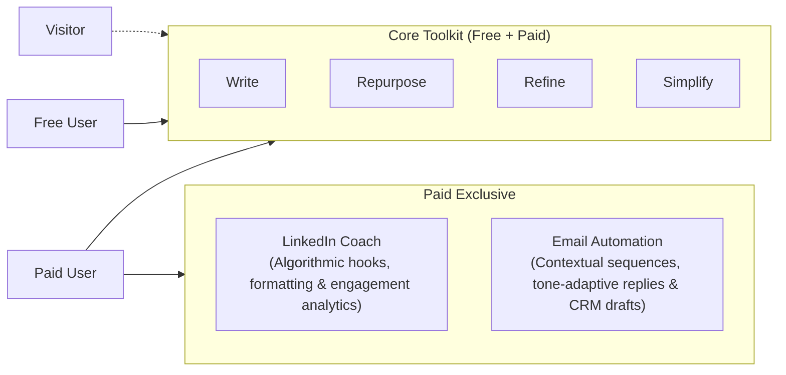

# ContentCraft AI — Product Requirements Document (PRD)

> **Document Status:** Active / Authoritative Reference  
> **Last Updated:** October 2026  
> **Target Audience:** Engineering, Product, and Stakeholders

---

## 1. Executive Summary & Vision

**ContentCraft AI** is a focused content productivity workspace built to help creators, professionals, and teams turn raw thoughts into impactful, clear content. The product provides intuitive, high-clarity writing transformations with minimal cognitive overhead.

### 1.1 Core Value Proposition
- **Distraction-free creation:** A serene, clean interface with no unnecessary visual clutter.
- **Predictable, transparent utility:** Fast, meaningful transformations without ambiguous lock-ins.
- **Fair-use operational sustainability:** A financial philosophy where premium subscription fees exist strictly to support actual underlying compute and infrastructure expenses rather than developer profit markups.

---

## 2. User Roles & Account Hierarchy

ContentCraft AI structures user access into three deliberate tiers:

| Tier / Role | Authentication | Target Persona | Access Level & Capabilities |
|---|---|---|---|
| **Visitor** | Unauthenticated (No signup required) | Evaluators, first-time landing page visitors | In-page interactive sandbox ("Try it once") with pre-populated samples and deterministic local demonstrations of the core tools. |
| **Free User** | Authenticated (Account required) | Regular writers, personal users | Full standard access to the four core tools, standard workspace, and limited baseline personal history. |
| **Paid User** | Authenticated + Active Subscription | High-volume professionals, founders, marketers | Complete access to the four core tools with elevated quotas, plus exclusive access to advanced features (**LinkedIn Coach** and **Email Automation**). |

---

## 3. Feature Breakdown

### 3.1 The Four Core Tools (Free & Paid)
The foundation of the writing workspace revolves around four primary transformation modalities:

1. **Write (First Draft):**
   - *Purpose:* Transforms a rough concept, quick bullet points, or unstructured notes into a coherent initial draft.
   - *Typical Use Cases:* Team updates, project announcements, kickoff briefs.

2. **Repurpose (Cross-Channel):**
   - *Purpose:* Adapts existing copy into alternative delivery formats while preserving the core thesis.
   - *Typical Use Cases:* Turning meeting takeaways or articles into structured social posts, summaries, or briefs.

3. **Refine (Voice & Clarity):**
   - *Purpose:* Polishes sentence flow, improves vocabulary precision, and enhances persuasiveness while retaining the author's original voice.
   - *Typical Use Cases:* Polishing emails, memos, executive updates, and client communications.

4. **Simplify (Plain Language):**
   - *Purpose:* Demystifies convoluted sentences, removes unnecessary corporate jargon, and ensures readability across broad audiences.
   - *Typical Use Cases:* Technical documentation summaries, policy explanations, customer-facing clarifications.

---

### 3.2 Paid-Exclusive Features

To maintain cost control over heavy AI compute workloads and deliver high-leverage workflows for power users, two advanced capabilities are designated as **Paid-exclusive**:

#### 1. LinkedIn Coach
- **Concept:** An intelligent assistant focused on professional social content strategy.
- **Capabilities:**
  - Hook generation and opening line scoring to improve dwell time.
  - Readability and skim-formatting optimization (line-breaks, whitespace rhythm, mobile view preview).
  - Hashtag and call-to-action (CTA) recommendation based on domain topic.
  - Persona calibration (e.g., industry thought leadership, founder journey, technical breakdown).
- **Justification for Paid Exclusivity:** Requires multi-pass prompt chains and larger context windows, generating significantly higher API token usage than simple paragraph rewriting.

#### 2. Email Automation
- **Concept:** A targeted drafting assistant for repetitive and high-stakes email communication workflows.
- **Capabilities:**
  - Generation of multi-touch follow-up sequences from brief meeting notes.
  - Tone-adaptive response generation (e.g., firm negotiation, polite postponement, concise executive response).
  - Structured summaries of email threads with suggested actionable replies.
- **Justification for Paid Exclusivity:** Processing full message threads and synthesizing sequential multi-step templates demands extensive token consumption and backend orchestration.

---

## 4. Packaging, Pricing Philosophy & Cost Transparency

### 4.1 Single Paid Tier
To eliminate decision fatigue and avoid coercive tier ladders, ContentCraft AI maintains a **single, all-inclusive Paid tier** rather than fragmented "Starter / Pro / Team / Enterprise" tiers.

### 4.2 Transparent At-Cost Pricing Philosophy
- **Core Principle:** Subscription pricing is structured to cover **actual AI API model inference, serverless compute, database persistence, and payment gateway infrastructure costs**—not developer profit extraction.
- **User Trust & Openness:** Users are given clear explanations of where subscription fees go (model token ingestion/generation costs, secure storage, and platform operations).
- **Alignment of Incentives:** The platform succeeds when users generate high-quality content efficiently, not when users are locked into inflated monthly retainers.

---

## 5. Usage Limits & Risk Management

### 5.1 The Challenge of Variable API Costs
External Large Language Model (LLM) APIs charge dynamically per token (input + output). Without guardrails, heavy or automated usage by a small subset of accounts can create significant financial deficits for an at-cost service.

### 5.2 Usage-Limit Requirements
To ensure sustainability while maintaining generous allowances:

1. **Deterministic Quota Accounting:**
   - Both Free and Paid tiers must have explicit, predictable usage quotas (e.g., monthly token budgets, daily transformation caps, or generation credits).
   - Usage consumption must decrement consistently based on request complexity and output length.

2. **Graceful Degradation & Warning UX:**
   - Visual quota indicators in the user workspace (e.g., "75% of monthly allowance remaining").
   - Friendly in-app notifications as limits approach, preventing unexpected mid-workflow interruptions.
   - Hard stop safeguards when quotas are exhausted, with clear reset date indications.

3. **Protection Against Abuse:**
   - Rate-limiting at the route handler layer to mitigate scripted automation or scraping.
   - Input size constraints (maximum character/token boundaries per single submission).

---

## 6. Pending Implementation Decisions & Open Questions

The following operational details remain unconfirmed and are intentionally flagged as pending further evaluation:

| Item | Status | Considerations & Next Steps |
|---|---|---|
| **Exact Subscription Pricing** | **Pending** | Needs empirical benchmarking of average user token consumption against current model provider token rates. |
| **Exact Free & Paid Quota Caps** | **Pending** | Dependent on the final choice of primary vs. fallback AI model (e.g., Gemini Flash vs. Pro tiers). |
| **Payment Gateway Provider** | **Pending** | Evaluation required between Stripe, Lemon Squeezy, or Paddle for global tax compliance, merchant of record support, and low transaction fees. |
| **Database & Session Schema** | **Pending** | Technical specification required for user role flags (`role: "free" | "paid"`), billing cycle renewal hooks, and token ledger counters. |
| **AI Model Routing Architecture** | **Pending** | Determination of whether to use unified model endpoints or route basic tools to lightweight models and Paid features to reasoning models. |

---

## 7. User Experience & Interface Principles

1. **Clarity Over Complexity:** The UI remains centered on the writing canvas with minimal secondary menus.
2. **Transparent Billing State:** Subscribed users always have one-click access to their plan status, billing renewal date, and usage consumption.
3. **Responsive Consistency:** Desktop, tablet, and mobile layouts maintain equivalent workflow clarity and responsive parity.
4. **Accessible Feedback:** Every interactive operation (generating, copying, upgrading, or switching tools) provides non-intrusive visual and screen-reader accessible confirmations.

